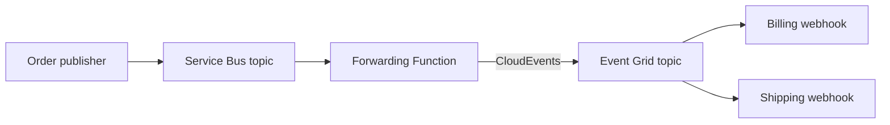

# Hi, I'm seilorjunior 👋

**Application Modernization & AI · Cloud Architecture · DevOps**

I focus on modernizing applications on **Azure**, building cloud-native systems with **Kubernetes**, and making delivery repeatable through **CI/CD** and **Infrastructure as Code**. My public projects explore AI API migration, resilient API gateways, and event-driven application integration.

Currently working at [Microsoft](https://www.microsoft.com).

## Featured Projects

### [Azure OpenAI Migration Toolkit](https://github.com/seilorjunior/openai-sdk-and-api-v1-migration)

- **Problem:** Assess migration from Azure AI Inference SDK and legacy endpoints to the OpenAI SDK and `/openai/v1`.
- **My contribution:** Implemented a read-only MCP assessment service. The proof of concept includes dual-mode APIM routing and structured migration findings.
- **Outcome & evidence:** Flags six legacy SDK/API patterns with file-and-line findings and exposes three read-only MCP assessment tools ([analysis and limitations](https://github.com/seilorjunior/openai-sdk-and-api-v1-migration#how-deprecated-api-analysis-works)).
- **Stack & deliverable:** Python, OpenAI SDK, Azure OpenAI, API Management, and MCP — a migration-assessment POC with sample policies and tests.

### [Load-Balanced Azure AI Content Safety](https://github.com/seilorjunior/apim-lb-content-safety)

- **Problem:** Expose two Azure AI Content Safety accounts through a shared API gateway with resilience controls.
- **My contribution:** Added gateway request-size checks; the template also includes managed-identity authentication, throttling, and retries.
- **Outcome & evidence:** Caps retried reads at four attempts and assigns named blocklists to deterministic backend owners rather than failing over to a potentially stale peer ([behavior and limits](https://github.com/seilorjunior/apim-lb-content-safety#notes--limitations)).
- **Stack & deliverable:** Bicep, Azure Developer CLI (`azd`), API Management, Azure Functions, and Python — an IaC deployment template with proxy tests.

### [Event-Driven Azure Messaging](https://github.com/seilorjunior/eventgrid-funout)

- **Problem:** Connect queued order publication to push-based distribution for billing and shipping subscribers.
- **My contribution:** Implemented the order publisher with correlation IDs; the demo forwards Service Bus messages to Event Grid as CloudEvents.
- **Outcome & evidence:** Demonstrates fan-out to two independent webhook subscribers, carrying correlation IDs from Service Bus into CloudEvents for downstream tracing ([event flow](https://github.com/seilorjunior/eventgrid-funout#event-flow)).
- **Stack & deliverable:** C#, ASP.NET Core, Azure Service Bus, Event Grid, Azure Functions, and `azd` — a deployable multi-service messaging demo.

**Simplified messaging architecture**

## Core Expertise

- **AI & APIs:** Azure OpenAI, OpenAI SDK, Model Context Protocol (MCP), and Azure API Management.
- **Cloud & architecture:** Azure, Kubernetes, microservices, serverless, and Azure Functions.
- **Delivery & automation:** GitHub Actions, Azure DevOps, Terraform, Bicep, and `azd`.
- **Development:** Python, C#/.NET, PowerShell, and Bash.
- **Observability:** Prometheus, Grafana, and Jaeger.

More technologies I work with

- **Containers:** Azure Red Hat OpenShift (ARO), Docker, and Helm.
- **CI/CD & quality:** Jenkins, SonarQube, Black Duck, and Nexus Repository.
- **APIs & messaging:** Kong and NATS.
- **Data:** Azure SQL, Cosmos DB, MongoDB, PostgreSQL, Elasticsearch, and Azure Managed Redis.
- **Languages & tools:** Go, Git, Linux, and VS Code.

## Selected Activity

[Explore my repositories](https://github.com/seilorjunior?tab=repositories) · [View contributions on GitHub](https://github.com/seilorjunior?tab=overview)

<picture>
  <source media="(prefers-color-scheme: dark)" srcset="https://raw.githubusercontent.com/seilorjunior/seilorjunior/output/github-snake-dark.svg" />
  <source media="(prefers-color-scheme: light)" srcset="https://raw.githubusercontent.com/seilorjunior/seilorjunior/output/github-snake.svg" />
  
</picture>

## Connect with Me

Let's collaborate on **Azure AI migrations**, **APIM resilience**, or **CI/CD and Infrastructure as Code tooling**. Open an issue or pull request in a featured repository with your use case or proposed improvement.

[LinkedIn](https://www.linkedin.com/in/seilorjunior) · [GitHub](https://github.com/seilorjunior)
